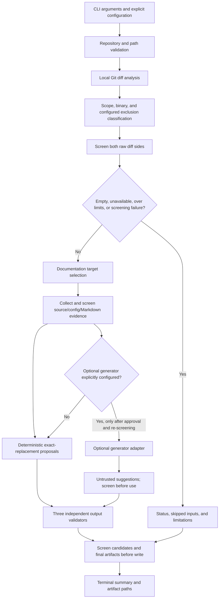

# Documentation Sync CLI Architecture

**Status: The user has explicitly given final approval to the amended architecture as the approved baseline for implementation planning.** This approval is not implementation evidence and does not imply that any tooling is configured. This document is not a design review or implementation plan. Approved requirements in `requirements.md` govern over the fictional story in `input/user_story.md`.

The scope, defaults, and safety behaviors explicitly approved for this architecture are recorded below as approved clarifications. Where these add detail beyond the original requirement text, they are labeled as approved clarifications rather than attributed to requirements that do not state them.

## Goals and Boundaries

The product is a Python 3.12+ local command-line application that analyzes selected changes from a local Git repository and writes a human-readable Markdown report and standard `.patch` file for developer review. Its core operates without a network connection, cloud service, web server, or CI system. It does not edit the repository's documentation, apply patches, commit, push, merge, or publish.

The initial scope is local Git diffs only. Pull-request diff analysis, direct application, arbitrary new documentation creation, and guaranteed semantic correctness are out of scope. Repository files, Git metadata, diff text, and optional model responses are untrusted inputs.

## Proposed Components

The following modular boundaries are required by the approved requirements. Names are illustrative; implementation structure is not yet selected.

| Component | Responsibility |
| --- | --- |
| CLI and run coordinator | Use standard-library `argparse` and `pathlib` to parse arguments and paths, resolve per-run settings, invoke stages, assemble status and counts, and return a clear process result. Keep orchestration thin. |
| Configuration and consent | Resolve repository, selected diff scope, configurable path exclusions, limits, output directory, and optional generator settings. External use is provider-neutral, disabled by default, and requires explicit configuration plus a clear notice that repository context may be transmitted externally. |
| Repository/path validation | Check repository and output paths, readability, Git repository identity, containment, and unsafe path conditions. Reject invalid inputs before analysis. |
| Git diff analysis | Use local Git CLI through Python `subprocess`, with argument arrays and no shell, bounded output, and timeouts. Obtain the selected scope and changed-file metadata; always skip binary inputs from content analysis, apply configured generated/irrelevant path exclusions, and enforce file-count and diff-size limits without truncation. |
| Documentation target selection | Consider all repository `.md` files (subject to optional configured path exclusions), using changed paths, diff, source evidence, and existing documentation. Return relevant targets, candidates/ambiguities, conflicts, or no-target status; do not create files. |
| Evidence collection and security filtering | Gather bounded source excerpts, changed-line context, relevant existing documentation, and provenance. Track omitted inputs and conflicts. Always exclude binary inputs from content analysis. Screen raw diff sides and each source/config/Markdown evidence item before downstream use; exclude or redact detected values, sanitize diagnostics, and fail closed if screening is incomplete or unreliable. Treat repository text as data, never instructions. |
| Proposal generation | Produce evidence-backed direct-replacement proposals for the bounded Python callable-signature and JSON/TOML scalar settings cases below without an LLM. Unsupported or uncertain cases yield uncertainty/`Not Found`. An optional LLM/API adapter remains disabled unless explicitly enabled; any suggestions remain untrusted and cannot bypass evidence, screening, unique-anchor, or validation gates. |
| Output validation | Run three independent validators against proposed content and the corresponding virtual documentation state: Markdown syntax/relevant formatting; relative links and local file references; source-to-documentation consistency and evidence sufficiency. |
| Patch/report writer | Produce exactly a standard `.patch` and detailed Markdown report in the selected output directory (default `docsync-output/`), separately from original documentation. Before diff collection, refuse the run if either target already exists, including on empty diffs. Independently recheck before writing and atomically create each absent target without replacement by linking a same-filesystem staged file; fail closed if this primitive is unavailable. Report partial write failures without deleting existing targets or the other artifact. |
| Terminal summary | Report execution status, analyzed and skipped inputs, proposals, each validation result, warnings/uncertainties, and artifact paths without printing repository secrets or unnecessary raw source. |

## Approved Architecture Choices

The following choices and defaults are explicitly approved and reflected as architecture constraints. Details not settled by them remain proposals or implementation-planning decisions, as labeled below.

| Decision | Approved choice and rationale | Unresolved detail |
| --- | --- | --- |
| CLI interface | Python 3.12+ with standard-library `argparse` and `pathlib`, keeping the local CLI on the standard library. | No CLI framework alternative is selected. |
| Git access and scope | Invoke local Git through Python `subprocess` using argument arrays, never a shell. Default working-tree scope is `git diff`: worktree compared with index (unstaged changes). Staged scope is `git diff --cached`: index compared with `HEAD`. Explicit base/head scope is `git diff <base> <head>`: compare the named endpoint trees directly, not an implicit merge-base comparison. Do not add a combined scope. Every report identifies the selected scope and endpoints as applicable. | Exact subprocess timeout/output bounds remain implementation-planning details. CLI option names and endpoint validation are proposals. |
| Markdown parsing | Use `markdown-it-py` with its CommonMark-compatible configuration as the baseline. Enable no optional extensions unless a requirement calls for one and the extension is documented. Parsing is not a complete style or semantic check. | Parser version and any later required extension are not selected. |
| Link validation | Resolve relative links and local file references locally against repository paths and the proposed virtual state; do not fetch remote URLs. | No remote URL validation is in scope. |
| Proposal generation | Keep core analysis, evidence collection, validation, and reporting local. The optional LLM adapter is provider-neutral and disabled by default; use requires explicit per-run configuration and informed approval. | No provider, credentials, or external transmission is assumed. Exact consent/configuration interface remains unresolved. |
| Generated and irrelevant inputs | Always skip binary inputs from content analysis. Allow configurable generated/irrelevant path exclusions and report each skipped input. Never classify an input as generated solely from its filename; do not invent default generated-file patterns. | Exclusion configuration syntax and binary identification details are proposals. |
| Secret handling | Screen before sinks, rescreen optional request context and outputs immediately before use/write, exclude detected values, and fail closed on screening/decoding failures or detected output leaks. Pattern checks cannot guarantee detection of all secrets; no complete-detection claim is permitted. | Exact patterns and redaction mechanics are implementation details; coverage remains inherently incomplete. |
| Output collision policy | Always refuse a run if either report/patch target exists. Check after canonical path validation and before diff collection, including empty-diff runs; the writer independently checks before creating output. Publish each staged artifact using same-filesystem atomic no-replace creation. If hard-link publication is unavailable, fail closed; never fall back to a replacing operation. Only the report and patch are generated; there is no ownership manifest. | The no-replace primitive is checked at runtime; unsupported publication fails closed. |
| Initial resource defaults | Preserve the approved maximum of 100 changed files and 1 MB textual diff per analysis. | Exact timeouts, per-file size, and memory limits are bounded implementation-planning decisions to finalize before implementation. |

GitHub Actions is the intended CI environment; `pytest` is the approved test framework; `pip-audit` and Bandit are proposed CI/security checks. All four remain proposed/intended checks whose availability and configuration are unverified; this architecture does not claim that any are configured or have been run. They are separate from the core runtime.

### Interfaces and Unresolved Decisions

Components exchange conceptual run configuration, selected-diff metadata/content, evidence with provenance, candidate proposals, independent validation results, and final report/artifact outcomes. These names describe information across boundaries, not fixed public APIs or implementation types. Stage results must preserve failure and inconclusive states rather than converting them to success.

- **CLI option names:** The scope semantics and working-tree default are approved, but exact flag names, mutual-exclusion behavior, and base/head input validation are proposals.
- **Resource ceilings:** Retain the approved defaults of 100 changed files and 1 MB textual diff. Exact timeouts, per-file size, and memory limits are bounded implementation-planning decisions to finalize before implementation.
- **Exclusion and binary handling details:** Configurable path exclusions and reporting every skip are approved. The configuration syntax and technical binary-detection mechanism remain proposals. Generated status must not be inferred from filename alone, and no default generated paths are assumed.
- **Optional adapter details:** Provider-neutral, disabled-by-default behavior and explicit per-run configuration/informed approval are approved. Provider, model, credential mechanism, and exact consent interaction are unspecified.
- **Output interaction:** No overwrite option exists. Existing report or patch targets always block the run. Canonical output paths are validated before diff collection, and the writer repeats the collision check. Publication atomically creates only absent targets using a same-filesystem staged hard link; unsupported platforms fail closed without a replacing fallback.
- **CI/security checks:** GitHub Actions is intended and `pip-audit`/Bandit are proposed; current availability and configuration are unverified.

## Data Flow

### Bounded Deterministic Proposal Contract

Deterministic local mode must produce actual proposals for only these initial supported cases; it does not require or call an LLM. These are a limited allowlist, not a promise to handle all source languages or configuration formats.

- **Python callable/API signature change:** Parse the old and new Python source with Python AST. Identify the same qualified callable in both versions and derive its complete old and new signatures. Create a proposal only when the complete old signature appears exactly once in an existing Markdown fenced-code block. Replace only that signature with the new signature. Do not create a target, rewrite explanatory prose, or alter other code-block content.
- **JSON/TOML scalar configuration value change:** Parse old and new JSON/TOML source and use the diff to establish one changed key/path and its old/new scalar values. Create a proposal only when exactly one existing structured Markdown settings row contains that same key/path and old value. Replace only the exact old value with the new value; preserve surrounding prose and structure.

For either case, retain evidence provenance including source path and diff hunk/line where available, and identify the existing Markdown target file and unique anchor. The required sequence is **evidence -> unique target anchor -> direct replacement proposal -> all validators -> patch/report**. Any unsupported language, format, or change; missing or duplicate anchor; ambiguous target/value; conflicting evidence; or inadequate evidence produces uncertainty/`Not Found` and no proposal. Do not use explanatory prose or a model suggestion to fill gaps. The optional LLM is not required for these proposals and remains disabled unless separately enabled under the approved external-use constraints.

### Source-Consistency Validator Contract

For every proposed changed signature/value, map the exact proposed value to source/diff provenance and the unique Markdown anchor it replaces. Pass only mechanically verifiable changes in the supported deterministic set. Contradictory, unsupported, or conflicting evidence fails or warns as appropriate. Missing or uncheckable evidence is inconclusive, never pass; evidence insufficient to support the proposal withholds it. The validator is bounded and makes no claim of semantic completeness. Tests cover each outcome, including provenance/anchor mapping, contradiction, unsupported changes, conflicts, and missing evidence.

### Screening and Fail-Closed Contract

- Screen both old and new raw diff sides, and every source/config/Markdown evidence item, before it enters logs, reports, proposal context, or optional requests. Screen and sanitize diagnostics; never log raw diffs, detected values, or exception text that may contain them.
- Exclude/redact detected secret values so they do not appear in reports, patches, logs, or optional LLM payloads. If removing sensitive evidence leaves insufficient support, withhold the proposal. Pattern-based checks cannot guarantee discovery of every secret; never claim complete detection.
- Immediately before an optional request, screen again and send only approved, sanitized, relevant context. Never intentionally send detected secrets or credentials.
- Screen each candidate proposal and the final report/patch immediately before writing. If a candidate or output contains a detected value, withhold that proposal/artifact and report only a sanitized outcome. If screening fails, decoding is incomplete, or screening cannot complete reliably, fail closed for the affected operation: no proposal, no optional request, and no artifact containing unscanned data. Emit only a fixed sanitized status/report where safe.

1. Validate the repository and canonical output directory/target paths before reading repository content. If either target exists, stop before diff collection or Markdown inventory, even for an empty diff. The writer independently refuses existing targets. Default working-tree scope compares worktree to index (`git diff`, unstaged changes). Staged scope compares index to `HEAD` (`git diff --cached`). Explicit base/head compares the named endpoint trees (`git diff <base> <head>`), not an implicit merge base. The report identifies the selected scope and named endpoints where applicable; no combined scope is included.
2. Obtain the selected local Git diff through the approved subprocess boundary and screen both old and new raw diff sides before further processing, logging, reporting, proposal context, or optional requests. If decoding or screening is incomplete or unreliable, fail closed for the affected operation. Apply initial defaults of **100 changed files** and **1 MB textual diff**. Exceeding either limit is reported with affected inputs; evidence is not silently truncated and proposals must not rely on incomplete context.
3. Always skip binary inputs from content analysis. Apply configured generated/irrelevant path exclusions, and report each skipped input and reason. Do not infer generated status solely from a filename or assume default generated-file patterns. Unsupported inputs are also skipped and reported. Empty/unavailable diffs and limit excess produce clear status and no unrelated proposals.
4. Select from all repository `.md` files, respecting configured exclusions. Propose multiple targets only when relevance is clear and proposed updates do not duplicate or contradict. List ambiguous candidates and conflicting existing docs for human resolution. If there is no suitable target, report that fact; do not create arbitrary files.
5. Collect bounded evidence from diff, source/configuration files, paths, and existing Markdown. Screen each evidence item before it is used or enters logs, reports, proposal context, or optional requests. Exclude/redact detected values; if redaction leaves insufficient evidence, withhold the proposal. Keep source path, source location, diff hunk/line where available, and exact Markdown anchor provenance. Pattern-based checks cannot guarantee detection of every secret.
6. In deterministic mode, use only the Python AST callable-signature and JSON/TOML scalar settings-row cases in **Bounded Deterministic Proposal Contract**. Require a unique exact anchor and emit only a direct replacement. Unsupported, ambiguous, conflicting, or inadequately evidenced cases yield uncertainty/`Not Found` and no proposal. The optional adapter is disabled unless explicitly enabled with informed approval; re-screen and send only approved sanitized relevant context. Its suggestions cannot bypass the supported-change and evidence gates.
7. Run all three independent validators on each candidate and its proposed virtual Markdown state; report pass, fail, warning, or inconclusive. The source-consistency validator follows **Source-Consistency Validator Contract**; missing or uncheckable evidence is never a pass.
8. Screen candidate proposals and the final report and patch immediately before writing. If a candidate/output contains a detected value or screening fails, withhold it and return only a sanitized outcome. Write no artifact containing unscanned data. Refuse the run if either target exists, both during preflight before diff collection and independently in the writer. Stage both artifacts on the output filesystem and publish each with atomic no-replace creation (`os.link`); if unsupported, fail closed without a replacing fallback. The two publications are not a transaction: report accurate partial outcomes, preserve any pre-existing target, and clean up only this run's temporary files. The patch is proposal-only and is never applied. Generate only the report and patch, with no ownership manifest.

## Trust and Security Boundaries

- **Local repository boundary:** Repository contents and Git data are untrusted. Embedded instructions, including prompt-injection text, are treated only as quoted/data evidence and cannot alter requirements, configuration, or tool behavior. Do not execute repository-provided scripts as part of analysis.
- **Process boundary:** Invoke Git through Python `subprocess` with argument arrays, no shell, bounded output, and timeouts. Exact bounds remain unresolved. Avoid following paths outside the intended repository during evidence reads. Validate canonical output paths and reject source-input collisions, symlinks, and escapes; existing artifact names always block output.
- **Secrets boundary:** Screen both old/new raw diff sides and every source/configuration/Markdown evidence item before it enters logs, reports, proposal context, or optional requests. Sanitize diagnostics; never log raw diffs, detected values, or exception text that may contain them. Exclude/redact detected values from proposals and outputs; if evidence becomes insufficient, withhold the proposal. Re-screen before optional requests and immediately before writing candidate proposals and final report/patch. If screening/decoding is incomplete or unreliable, fail closed for the affected operation: no proposal, no optional request, and no artifact containing unscanned data. A fixed sanitized status/report may be emitted only where safe and contains no repository-derived content. Pattern checks cannot guarantee discovery of every secret; do not claim complete detection or guaranteed secret-free output.
- **Output boundary:** Write only `docsync-report.md` and `docsync.patch`; never edit source Markdown or perform apply/commit/push/merge/publish actions. Either existing target blocks the run, including before empty-diff analysis. Independently guard publication with same-filesystem atomic create-if-absent hard links; fail closed if unavailable. Report partial outcomes and never delete an existing file.

## Failure and Resource-Limit Behavior

Use structured per-stage outcomes so failures remain visible rather than being converted to success. Invalid/unreadable repository paths, non-repositories, Git failures, empty diffs, no targets, ambiguous targets, conflicting evidence, unavailable generators, validator failures, and artifact write failures receive actionable status and details. A partial run may still produce a report of findings and limitations, but it must not claim unsupported proposals or successful checks.

The initial limits are 100 changed files and 1 MB of textual Git diff per analysis. Check limits before proposal generation; do not silently trim evidence. On excess, identify affected files and report a limit-exceeded status. Binary inputs are always skipped from content analysis. Configured generated/irrelevant path exclusions and unsupported files are skipped and each skip is reported. Do not classify generated files solely by filename or invent default generated paths. Bound subprocess duration and output and avoid unbounded repository-file loads. Exact timeouts, per-file size, and memory limits are bounded implementation-planning decisions to finalize before implementation; do not invent approved values. Any limit behavior must not silently truncate evidence.

## Validation and Test Strategy

All three output validations are separate modules with independent unit-test surfaces and explicit `pass`, `fail`, `warning`, or `inconclusive` results:

1. **Markdown syntax/relevant formatting:** Parse proposed Markdown with `markdown-it-py` using its CommonMark-compatible configuration as the baseline. Enable no optional extensions unless required and documented. Detect applicable structural/formatting failures. A successful parse is not a guarantee of semantic correctness.
2. **Relative links/local references:** Resolve references in affected documentation locally against repository paths and the proposed virtual file state. Report broken and unresolved references; do not fetch remote URLs.
3. **Source-to-documentation consistency:** For every changed value/signature, map the proposal to exact diff/source provenance and its unique Markdown anchor. Pass only mechanically verifiable supported changes; contradiction, unsupported changes, or conflicts fail or warn as appropriate. Missing or uncheckable evidence is inconclusive, never pass, and required missing support withholds the proposal. This bounded check is not semantically complete.

Use `pytest` as the intended test framework for unit tests of each module and integration tests against temporary local Git repositories; its availability/configuration are unverified. Cover valid/invalid paths, empty diffs, each approved diff scope, multiple/ambiguous/conflicting targets, no target, skipped files, limits/no truncation, prompt-injection-like text, disabled/failing optional generator, output collisions, partial writes, and unchanged source docs/Git state. For deterministic proposals, test Python AST matching of the same qualified callable, unique versus missing/duplicate fenced signature anchors, and direct signature-only replacement; test JSON/TOML changed scalar path/value matching, unique versus missing/duplicate settings rows, and exact value-only replacement. Test unsupported formats/changes, ambiguity, conflicts, and inadequate evidence yield uncertainty/`Not Found` and no proposal. Independently test source-consistency pass, fail, warning, and inconclusive outcomes, including exact provenance/anchor mapping and unsupported/conflicting/missing evidence. Include secret fixtures and assert their values are absent from report, patch, logs, and fake adapter payload; scanner failure and output-scan leak must produce sanitized fail-closed results with no proposal/request or artifact containing the value. Test that redaction leaving insufficient evidence yields no proposal. Include CLI end-to-end tests without network access; live API calls are not required for core tests.

GitHub Actions is the **intended/proposed** CI environment only. `pytest`, `pip-audit` for dependency vulnerabilities, and Bandit for common Python security issues are **proposed** checks, not verified available or configured. Keep scanning outside the application runtime; report tool unavailability, scan failures, and unresolved findings accurately. No check may be reported as passed unless it actually ran successfully.

## Requirement Traceability

| Approved requirement | Architecture coverage |
| --- | --- |
| FR-01, AC-09; NFR-01 | Local Git CLI via Python `subprocess`; standard-library `argparse`/`pathlib`; approved working-tree default, staged scope, and explicit base/head endpoint semantics; report identifies selected scope; no PR, server, cloud, or CI runtime dependency. |
| FR-02, FR-03; AC-10, AC-11 | Target selection across repository Markdown, optional exclusions, multiple supported targets, ambiguity/conflict reporting, no arbitrary files. |
| FR-04; AC-02, AC-03 | Bounded deterministic Python signature and JSON/TOML scalar replacements require exact evidence and one existing Markdown anchor; attach provenance, preserve surrounding text, and use uncertainty/`Not Found` without proposals for unsupported, ambiguous, conflicting, or insufficiently evidenced cases. |
| FR-05, FR-08; AC-07, AC-12 | Exactly two report/patch outputs; unconditional collision refusal before diff collection and in the writer; canonical path, symlink, and source-input safety; same-filesystem atomic create-if-absent publication with no replacing fallback; truthful partial outcomes; no original-document edits or automatic application/action. |
| FR-06; AC-13; NFR-07 | Three independent validations, explicit result states, bounded source-consistency provenance/anchor contract, inconclusive when evidence is missing/uncheckable, no semantic guarantee. |
| FR-07, FR-10; AC-05, AC-06, AC-15 | Terminal summary, detailed report, clear empty/error/partial-artifact outcomes and artifact paths. |
| FR-09; AC-14 | Initial 100-file/1 MB defaults, binary inputs always skipped from content analysis, configurable generated/irrelevant path exclusions with every skip reported, no filename-only generated classification, and no silent truncation or incomplete-evidence claims. |
| FR-11; AC-16; NFR-04 | Deterministic supported proposals work without an LLM. Optional provider-neutral adapter disabled by default; before an optional request re-screen and send only approved sanitized relevant context; explicit configuration and informed approval plus clear external-transmission notice; no assumed provider/key/transmission setup; never intentionally send detected secrets; local core remains usable; untrusted content handling. |
| NFR-02; AC-13 | Modular component boundaries, independently testable validations, pytest strategy. |
| NFR-03 | `markdown-it-py` CommonMark-compatible configuration; no optional extensions unless required and documented; no remote link fetching or unnecessary infrastructure. |
| NFR-05 | Reviewable patch, reasons/evidence, uncertainty and limitations visible. |
| NFR-06; AC-17 | GitHub Actions, `pip-audit`, and Bandit identified only as intended/proposed separate checks, not verified configuration. |

| Approved clarification | Architecture coverage |
| --- | --- |
| Approved diff-scope clarification | Default working-tree `git diff` (worktree vs index, unstaged); staged `git diff --cached` (index vs `HEAD`); explicit `git diff <base> <head>` comparing named endpoint trees, not merge-base; report identifies scope; no combined scope. |
| Approved input-handling clarification | Binary always excluded from content analysis; configurable generated/irrelevant path exclusions, each skip reported; generated classification never based solely on filename; no invented default generated patterns. |
| Approved secret-handling clarification | Screen raw diff sides and every evidence item before sinks; sanitize diagnostics; rescreen optional requests and candidate/final outputs; detected values excluded from reports, patches, logs, and requests; fail closed on scanner/decoding failure or detected output leak; pattern checks cannot guarantee detection of all secrets. |
| Approved optional-LLM clarification | Provider-neutral and disabled by default; explicit configuration and clear external-transmission notice required before enabling; no provider/key/transmission setup assumed; existing failure/insufficient-support behavior retained. |
| Approved output/resource clarification | Always refuse if either artifact target exists; preflight before diff collection even for empty diffs and independently check in the writer. Use same-filesystem atomic no-replace creation and fail closed if unavailable. Create no ownership manifest or other generated artifact. Keep 100 changed files and 1 MB textual diff; finalize timeout, per-file size, and memory bounds before implementation. |

## Remaining Unresolved Assumptions and Decisions

- CLI flag names, exact base/head endpoint validation, and error behavior for invalid revisions are proposals; the scope semantics/default and report identification are approved.
- Exact subprocess timeouts/output bounds, per-file size limits, and memory limits are bounded implementation-planning decisions to finalize before implementation. The approved initial defaults remain 100 changed files and 1 MB textual diff.
- Exclusion configuration syntax and binary-detection mechanics remain proposals. No default generated-file patterns are approved; generated status cannot be assigned solely from filename.
- Secret-pattern selection and redaction mechanics remain implementation details. Pattern checks are not complete detection; fail-closed behavior and exclusion of detected values from reports, patches, logs, and optional requests are architectural constraints.
- The exact optional-generator configuration/notice interface remains a proposal. No provider, key, or external transmission configuration is assumed.
- Overwrite support is not available. Existing outputs always block; no-replace atomic publication is required and unsupported platforms fail closed. Canonical path and symlink checks remain mandatory.
- GitHub Actions, `pytest`, `pip-audit`, and Bandit are proposed/intended checks with availability/configuration unverified; none is represented as already configured or run.

This approved architecture does not claim implementation evidence. Its output policy is unconditional refusal with atomic no-replace publication; it does not authorize replacement or additional generated artifacts.